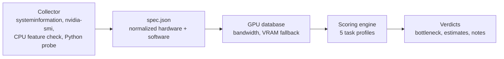

# ML Compat Checker

> Find out what your PC or laptop can really do for machine learning, and *why*.


Spec sheets tell you what hardware you have. They don't tell you whether you can fine-tune a 7B model on it, run SDXL comfortably, or whether the PyTorch you installed even supports your GPU. ML Compat Checker reads your machine, cross-checks it against common ML workloads, and gives a verdict for each one with the **bottleneck named**, not just a score.

**Status:** the detection and scoring engine works from the command line. The desktop app (Electron) is next. See the [roadmap](#roadmap).

---

## What it checks

| Task | What decides the verdict |
|---|---|
| **Classical ML** (scikit-learn, XGBoost) | System RAM and CPU threads |
| **Deep learning training** (CNNs, small transformers) | GPU VRAM |
| **Local LLM inference** (4-bit) | VRAM, plus a memory-bandwidth speed estimate |
| **LLM fine-tuning** (QLoRA) | VRAM after room for activations, and system RAM |
| **Image generation** (Stable Diffusion, SDXL, Flux) | GPU VRAM |

Every verdict is one of **GOOD**, **LIMITED** or **NOT RECOMMENDED**, and comes with a bottleneck, an estimate, and the reasoning behind it. Free disk space can also cap a verdict, since models and checkpoints are large.

GPU tasks also report a **software status**:

| Status | Meaning |
|---|---|
| `ready` | PyTorch (or the NVIDIA driver, for LLM inference) is set up and supports your GPU |
| `needs_setup` | The hardware is fine but PyTorch isn't installed |
| `needs_fix` | Something is installed but won't work: a CPU-only PyTorch build, a build that doesn't support your GPU's architecture, or a driver problem |
| `unknown` | Couldn't be checked (no Python found, or a non-NVIDIA GPU) |

This matters on new hardware. A brand-new GPU can be perfectly capable and still fail with an older PyTorch build.

---

## Quick start

**Requirements:** Node.js 18 or newer (developed on Node 24). NVIDIA features use `nvidia-smi`, which ships with the NVIDIA driver. Python is optional and only used to detect PyTorch.

```bash
git clone https://github.com/Garnavya/ml-compat-checker.git
cd ml-compat-checker
npm install

npm run collect -- --out spec.json   # read this machine's hardware and software
npm run collect -- --out spec.json --python "C:\path\to\python.exe"   # optional: check a specific environment
npm run evaluate                     # score it against the ML task profiles
npm test                             # run the test suite
```

`npm run evaluate` reads `spec.json` by default, or pass a path: `npm run evaluate -- path/to/spec.json`. That means you can collect on one machine and evaluate on another.

### Example output

From a laptop with an RTX 5050 (8 GB VRAM) and 16 GB RAM:

```text
Local LLM inference (4-bit)
  Verdict:    GOOD
  Estimate:   up to ~11.7B parameters at 4-bit, or ~2.9B at FP16 (estimate)
  Speed:      ~40-56 tokens/s for 8B-class 4-bit models (rough; real speed depends on software and power limits)
  Software:   ready
  - 8 GB VRAM minus 1 GB reserved leaves 7 GB for the model.
  - NVIDIA driver detected. llama.cpp-based tools (Ollama, LM Studio) need only the driver, not PyTorch.

LLM fine-tuning (QLoRA)
  Verdict:    LIMITED
  Bottleneck: GPU memory (VRAM)
  Estimate:   QLoRA on models up to ~6.7B parameters; 7B only with short context and small batches (estimate)
  Software:   ready
  - 8 GB VRAM minus 1 GB reserved and ~3 GB for activations and optimizer state.
  - PyTorch 2.11.0+cu128 detects the GPU and supports its architecture.

Notes
  - Laptop GPU (maximum reported power: 75 W): sustained speed depends on power limits and cooling, so long runs may be slower than short tests.
  - One RAM module detected (likely single-channel). A second matching module usually improves CPU-side speed.
```

---

## How it works



**Collector.** Gathers raw data per OS and normalizes it into one JSON spec. Where one source is unreliable, another is used: VRAM and compute capability come from `nvidia-smi` rather than WMI (which misreports modern GPUs), and AVX2/AVX-512 support comes from a direct OS query rather than a CPU flags string that is incomplete on Windows. A value that can't be detected is `null`, never a guess, and `detection_notes` explains why.

**GPU database.** `data/gpus.json` adds what detection can't provide: memory bandwidth (used for the speed estimate) and a VRAM fallback for AMD and Intel cards where detection is weak. Matching is exact on the normalized name, so `RTX 4060` and `RTX 4060 Laptop` are different cards, and an unknown GPU is reported as unknown instead of guessed.

**Scoring engine.** Pure functions that take the spec and a task profile. Thresholds live in `src/scoring/profiles.js`, so tuning a verdict is a data change, not a code change.

### The estimates

These are rules of thumb, not benchmarks, and the output labels them as estimates:

- **LLM inference:** 4-bit weights ≈ 0.5 bytes per parameter, plus 20% overhead, with 1 GB of VRAM reserved for the OS and display.
- **QLoRA:** the same weight math, plus about 3 GB for activations and optimizer state.
- **Speed:** token generation is memory-bandwidth bound, so the ceiling is roughly bandwidth ÷ model size, and real speeds typically reach 50-70% of it.
- **Classical ML:** roughly 60% of RAM usable for data, with about 3× overhead during training.

If a verdict feels wrong for your machine, the constants are in `src/scoring/engine.js` and the thresholds in `src/scoring/profiles.js`. Real measurements are very welcome (see [Contributing](#contributing)).

### Spec format

```json
{
  "schema_version": 1,
  "system": { "os": "windows", "form_factor": "laptop", "virtualized": false, "wsl": false },
  "cpu": { "model": "Intel Core i5-13420H", "threads": 12, "avx2": true, "avx512": false },
  "ram": { "total_gb": 15.7, "type": "DDR4", "speed_mhz": 3200, "modules": 1 },
  "gpus": [
    {
      "vendor": "nvidia",
      "model": "NVIDIA GeForce RTX 5050 Laptop GPU",
      "vram_gb": 8,
      "compute_capability": "12.0",
      "is_integrated": false
    }
  ],
  "software": { "python": "3.11.9", "torch": "2.11.0+cu128", "torch_cuda_available": true },
  "detection_notes": []
}
```

(Trimmed. The real file has more fields.)

---

## Privacy

Everything runs locally and nothing is sent anywhere. The spec deliberately leaves out serial numbers, MAC addresses and hostnames. To produce the spec, the collector runs these local commands:

- `nvidia-smi` for NVIDIA GPU details
- `nvcc --version` to detect a CUDA toolkit
- `python` or `python3`, which runs the short script `src/collector/probe_torch.py` to detect PyTorch (it imports `torch` if installed)
- PowerShell on Windows, to ask the OS which CPU instruction sets are supported
- Whatever OS commands the `systeminformation` library uses internally

On Linux it also reads `/proc/cpuinfo` and `/proc/version`.

“Python environment paths are recorded with your home folder replaced by ~, so the spec never contains your username.”

---

## Limitations

- **Only tested on Windows so far.** The Linux code paths are written but haven't been run on real Linux hardware yet.
- **NVIDIA is the best-supported vendor.** AMD and Intel GPUs get a hardware-only verdict with `unknown` software status, and rely on the GPU database for VRAM.
- - **PyTorch detection checks several Python environments** (the Python on `PATH`, any active virtual or conda environment, installs listed by the Windows `py` launcher, and conda's environment list), but can't discover an arbitrary virtual environment. For those, pass `--python <path>` when collecting.
- **Some fields may be unavailable.** RAM type and speed can need elevated rights, and laptop GPUs often report their power limit as N/A.
- **Estimates are not benchmarks.** Thermals, drivers and software all change real-world speed.
- **The GPU database is a starter set.** Entries marked `"verified": false` were not checked against manufacturer spec sheets yet.
- **macOS is out of scope.** Apple Silicon comes in a small, well-documented set of configurations, so a checker adds little there.

---

## Project structure

```text
ml-compat-checker/
├── data/
│   └── gpus.json            # GPU database
├── src/
│   ├── collector/           # hardware and software detection
│   │   ├── index.js         # collect() builds the normalized spec
│   │   ├── nvidia.js        # nvidia-smi queries
│   │   ├── cpufeatures.js   # AVX2 / AVX-512 detection
│   │   ├── software.js      # Python, PyTorch, CUDA toolkit
│   │   ├── probe_torch.py   # small script run by software.js
│   │   └── utils.js         # safe command runner
│   ├── scoring/
│   │   ├── profiles.js      # task profiles and thresholds
│   │   ├── engine.js        # evaluate() and evaluateAll()
│   │   └── gpudb.js         # GPU matching and enrichment
│   └── cli/
│       ├── collect.js       # npm run collect
│       └── evaluate.js      # npm run evaluate
└── tests/                   # node:test suites
```

---

## Roadmap

- [x] Hardware and software collector (Windows)
- [x] Scoring engine with five task profiles
- [x] GPU database with bandwidth-based speed estimates
- [x] Test suite
- [ ] Validate the collector on real Linux hardware
- [ ] Desktop app (Electron) with a verdict card per task
- [ ] Installers for Windows and Linux
- [ ] Refresh the GPU database from GitHub without reinstalling
- [ ] Optional short micro-benchmark to measure real throughput

---

## Contributing

The most useful contributions are small and concrete:

- **Add or verify a GPU** in `data/gpus.json`. Entries store the memory bus width and data rate (the numbers printed on spec sheets), and bandwidth is derived from them. Include a `source`, and set `"verified": true` only after checking an official spec page.

  ```json
  {
    "id": "rtx-4060-8gb",
    "vendor": "nvidia",
    "architecture": "Ada Lovelace",
    "aliases": ["rtx 4060"],
    "laptop": false,
    "vram_gb": 8,
    "mem_type": "GDDR6",
    "bus_bits": 128,
    "mem_gbps": 17,
    "compute_capability": "8.9",
    "source": "NVIDIA spec sheet",
    "verified": true
  }
  ```

- **Share real measurements.** If the tool says your machine can run something it can't (or the reverse), open an issue with your `spec.json` (it contains no serials or hostnames) and what actually happened. That's how the thresholds get better.
- **Test on Linux** and report what the collector got wrong.

Run `npm test` before opening a pull request. The tests check the GPU database's structure, so a malformed entry fails immediately.
